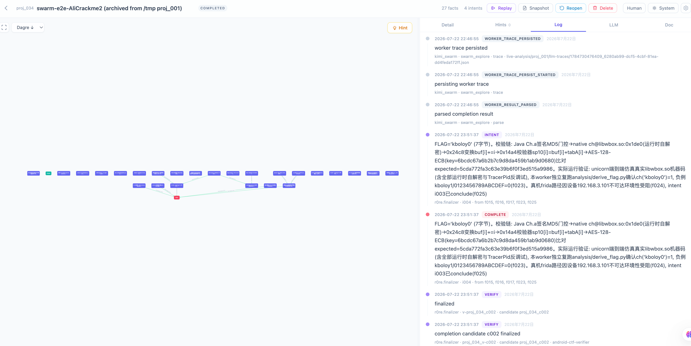

# r0re 中文使用文档

`r0re` 是一个本地 Android 逆向/CTF 分析编排工具。它提供 Web UI 保存项目状态，并通过 dispatcher 启动 Docker worker，让 Kimi Code 参与分析任务。

## 项目来源

`r0re` 最初基于 [oritera/Cairn](https://github.com/oritera/Cairn) 二次开发。Cairn 是一个 AI 通用状态空间搜索引擎，最早在自动化渗透测试场景中完成验证。Cairn 由 [起零衍迹 / oritera](https://github.com/oritera) 维护，这是一个专注 AI 应用与 Agent 工程前沿探索的开源组织，致力于技术开源与社区共建，安全攻防是其深耕方向之一。

在 `r0re` 自身后续开发中，本项目也借鉴了 [FishCodeTech/muteki](https://github.com/FishCodeTech/muteki) 的多 Agent CTF 协作设计，尤其是共享黑板机制。

当前公开版本使用 Kimi swarm 配置模板：`dispatch.kimi.swarm.example.yaml`。真实 API key、本地 APK 和分析输出只保存在用户本机。

## 1. 环境要求

请先在宿主机安装：

- Docker 或 Docker Desktop
- Java 17+
- Gradle，或项目根目录下的 `./gradlew`
- `curl`
- `python3`
- Kimi API key

检查环境：

```bash
./scripts/check-env.sh
```

## 2. 安装

```bash
git clone https://github.com/fyrlove/r0re.git
cd r0re
./scripts/setup-dev.sh
```

`setup-dev.sh` 会自动：

- 从 `.env.example` 生成本地 `.env`
- 从 `dispatch.kimi.swarm.example.yaml` 生成本地 `dispatch.kimi.swarm.yaml`
- 创建 `output/` 和 `container-android/test_apk/`
- 构建 Docker worker 镜像 `cairn-android-reverse:latest`
- 构建 r0re Spring Boot jar

## 3. 配置 Kimi

编辑 `.env`：

```env
KIMI_MODEL_API_KEY=你的_Kimi_Key
```

加载环境变量：

```bash
source .env
```

`.env` 和 `dispatch.kimi.swarm.yaml` 是本地文件，不需要提交到 Git。

## 4. 模型配置说明

本项目在开发和测试过程中使用过 GPT-5.4、GPT-5.5、GLM-5.1、Kimi K3。当前上传版本只保留 Kimi K3 的配置模板。

如果你想使用其他 AI 服务或模型，可以在拉取项目后，让本地 AI 编程助手基于 `dispatch.kimi.swarm.example.yaml` 帮你增加对应的 dispatch 配置。

## 5. Worker 数量配置

工作 worker 数量可以在 `dispatch.kimi.swarm.yaml` 中配置。当前默认模板配置为 3 个 Kimi worker：

```yaml
runtime:
  max_workers: 3
  max_project_workers: 3

workers:
  - name: "kimi_swarm"
    max_running: 3
```

你可以根据本机性能和 API 额度自主配置为 1、2 或 3 个。目前本项目最多只测试到 3 个 worker。

## 6. 放置 APK

把待分析 APK 放到：

```text
container-android/test_apk/
```

例如：

```text
container-android/test_apk/challenge.apk
```

## 7. 启动

```bash
source .env
./start-r0re.sh --no-bridge --config=dispatch.kimi.swarm.yaml
```

打开 Web UI：

```text
http://127.0.0.1:8001
```

在 Web UI 中创建或 resume 项目后，dispatcher 会按 `dispatch.kimi.swarm.yaml` 启动 Kimi worker。

## 8. 运行示例：看雪 Android CTF 题

下面截图是一个看雪论坛 Android CTF 比赛题的运行结果。该项目最终进入 `COMPLETED` 状态，右侧日志中可以看到 finalizer 完成验证并给出结果。



创建项目时可以这样填写：

```text
Origin:
分析放在 container-android/test_apk/ 目录下的看雪 Android CTF APK，恢复应用如何在 Java、JNI 和 native 代码中校验正确输入。

Goal:
恢复最终可接受的 flag/输入，并给出可复现的验证链路，证明 Java/native 校验都接受该结果。

Hint:
apk路径
```

本次示例运行的最终结果：

```text
FLAG='kboloy0'
```

截图中的运行状态示例：

- 项目：`swarm-e2e-AliCrackme2`
- 状态：`COMPLETED`
- 结果图谱：27 个 facts、4 个 intents
- 关键结论：Kimi worker 给出候选结果后，finalizer 完成验证并关闭项目

## 9. 停止

```bash
./start-r0re.sh --stop --no-bridge --port=8001 --config=dispatch.kimi.swarm.yaml
```

## 10. macOS 后台运行

安装 launchd 服务：

```bash
source .env
R0RE_PORT=8001 R0RE_CONFIG="$PWD/dispatch.kimi.swarm.yaml" ./scripts/r0re-launchd-install.sh
```

查看状态：

```bash
./scripts/r0re-launchd-status.sh
```

卸载：

```bash
./scripts/r0re-launchd-uninstall.sh
```

## 11. 常见问题

### Docker daemon 未运行

启动 Docker Desktop 或 Docker 服务后重新执行：

```bash
./scripts/check-env.sh
```

### Java 版本太低

需要 Java 17 或更高版本。安装后确认：

```bash
java -version
```

### 没有 Gradle

安装 Gradle，或在项目中加入 `./gradlew`。然后重新运行：

```bash
./scripts/setup-dev.sh
```

### Web UI 打不开

确认服务是否启动：

```bash
./scripts/r0re-health.sh 8001
```

也可以查看：

```text
output/r0re-serve.log
output/r0re-dispatch.log
```

## 12. 致谢

`r0re` 的设计和实现参考了以下开源项目：

- [oritera/Cairn](https://github.com/oritera/Cairn)：本项目最初的基础来源，提供了状态空间搜索、Fact/Intent 编排等核心思路。
- [FishCodeTech/muteki](https://github.com/FishCodeTech/muteki)：共享黑板机制和多 Agent CTF 协作流程的重要参考。
